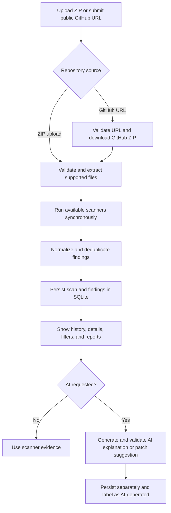

# Sentinel AI

Sentinel AI is a FastAPI and React application that accepts a repository ZIP or a public GitHub repository URL, extracts supported source files without executing them, runs available static and dependency scanners, stores normalized findings in SQLite, and presents scan history, reports, and finding details in a browser interface. Optional AI explanations and fix suggestions are generated separately from scanner evidence, labeled as AI-generated, validated, and kept for human review.

## Features

- Upload a repository as a ZIP archive.
- Scan a public GitHub repository or a public branch URL.
- Run Bandit, Semgrep, pip-audit, and npm audit when their tools and applicable inputs are available.
- Normalize scanner output into findings with severity, confidence, category, source location, evidence, snippets, and optional CWE identifiers.
- Browse scan history, filter findings, inspect scan coverage, and delete scans.
- Download JSON or Markdown reports, with AI content opt-in.
- Request cached or refreshed AI explanations and fix suggestions for findings.
- Apply upload, archive, extraction, subprocess, and concurrency limits.

## Screenshots

- [Overview](docs/screenshots/overview.png)
- [Scan details](docs/screenshots/scan-details.png)
- [New scan](docs/screenshots/new-scan.png)
- [Finding AI](docs/screenshots/finding-ai.png)

## How it works



## Tech stack

- Backend: Python, FastAPI, Pydantic, SQLAlchemy, SQLite, Uvicorn.
- Analysis tools: Bandit, Semgrep, pip-audit, and npm audit.
- Frontend: React, TypeScript, React Router, Vite, Tailwind CSS, and lucide-react.
- Tests: pytest and FastAPI TestClient/httpx.

## Getting started on Windows 11 PowerShell

From PowerShell:

```powershell
git clone <repository-url>
cd sentinel-ai
```

Optional: copy the example environment file and edit settings for your local setup:

```powershell
Copy-Item .env.example .env
```

Start the backend in one PowerShell window:

```powershell
Set-Location backend
py -m venv .venv
.\.venv\Scripts\Activate.ps1
python -m pip install -r requirements-dev.txt
uvicorn app.main:app --reload --port 8000
```

If PowerShell blocks activation, use the documented Python environment policy for your machine or invoke `backend\.venv\Scripts\python.exe` directly.

Start the frontend in a second PowerShell window:

```powershell
Set-Location frontend
npm install
npm run dev
```

Open the URL printed by Vite. For a first scan, use the ZIP at `sample-repos/vulnerable-python` after packaging that directory as a ZIP, or use the project's sample repository according to the frontend upload flow. The backend accepts ZIP files only; it does not execute uploaded source files.

## AI features

AI is optional. The default provider is local Ollama at `http://127.0.0.1:11434` with model `llama3.2:3b`; configure a different URL or model with the settings below. An OpenAI-compatible provider can be selected with `SENTINEL_AI_PROVIDER=openai_compatible`, `SENTINEL_AI_BASE_URL`, and `SENTINEL_AI_API_KEY`.

AI explanations and fix suggestions are requested per finding. Model output is parsed and validated before storage. Explanations are stored separately from scanner evidence. Fix suggestions are proposed text diffs, are marked as untested, and are never applied by the application. AI output is optional and should not be treated as scanner evidence.

## Configuration

Settings use the `SENTINEL_` environment prefix. The complete example is in [.env.example](.env.example).

| Setting | Default |
| --- | --- |
| `SENTINEL_APP_NAME` | `Sentinel AI` |
| `SENTINEL_APP_VERSION` | `0.1.0` |
| `SENTINEL_ENVIRONMENT` | `development` |
| `SENTINEL_CORS_ORIGINS` | `["http://localhost:5173","http://127.0.0.1:5173"]` |
| `SENTINEL_MAX_UPLOAD_BYTES` | `26214400` |
| `SENTINEL_MAX_ARCHIVE_ENTRIES` | `5000` |
| `SENTINEL_MAX_EXTRACTED_FILES` | `2000` |
| `SENTINEL_MAX_FILE_BYTES` | `1048576` |
| `SENTINEL_MAX_TOTAL_EXTRACTED_BYTES` | `104857600` |
| `SENTINEL_MAX_EXTRACTION_SECONDS` | `30.0` |
| `SENTINEL_SCANNER_TIMEOUT_SECONDS` | `60.0` |
| `SENTINEL_DATABASE_URL` | SQLite database under `backend/data/sentinel.db` |
| `SENTINEL_AI_PROVIDER` | `ollama` |
| `SENTINEL_AI_MODEL` | `llama3.2:3b` |
| `SENTINEL_AI_BASE_URL` | unset; Ollama uses `http://127.0.0.1:11434` |
| `SENTINEL_AI_API_KEY` | unset |
| `SENTINEL_AI_TIMEOUT_SECONDS` | `120.0` |

## API

The API is served under `/api`.

| Method | Path | Purpose |
| --- | --- | --- |
| GET | `/api/health` | Return application health, version, and environment. |
| POST | `/api/scans/upload` | Validate, extract, scan, store, and return a ZIP scan. |
| POST | `/api/scans/github` | Scan a public GitHub repository or branch URL. |
| GET | `/api/scans` | List scan history with `limit` and `offset`. |
| GET | `/api/scans/{scan_id}` | Return scan details and scanner runs. |
| GET | `/api/scans/{scan_id}/findings` | List findings with severity, category, scanner, search, file path, limit, and offset filters. |
| GET | `/api/scans/{scan_id}/report` | Download JSON or Markdown; `include_ai` is opt-in. |
| DELETE | `/api/scans/{scan_id}` | Delete a scan and its findings. |
| GET | `/api/findings/{finding_id}` | Return one finding. |
| POST | `/api/findings/{finding_id}/explain` | Generate or return a cached AI explanation; `refresh=true` regenerates. |
| GET | `/api/findings/{finding_id}/explanation` | Return a stored explanation. |
| POST | `/api/findings/{finding_id}/suggest-fix` | Generate or return a cached AI fix suggestion; `refresh=true` regenerates. |
| GET | `/api/findings/{finding_id}/fix` | Return a stored fix suggestion. |

## Testing

Run the backend tests from the backend directory:

```powershell
Set-Location backend
.\.venv\Scripts\python.exe -m pytest
```

The frontend package provides `npm run build` and `npm run lint`. There are no frontend unit tests in the current project.

## Security design summary

Uploaded archives are bounded, validated as ZIP files, checked for traversal, absolute paths, reserved names, duplicate entries, symlinks, special files, binary content, and extraction limits. Only supported source extensions and known filenames are extracted. Scanner subprocesses use argument lists rather than a shell, receive a restricted environment, have time and output limits, and run with bounded concurrency. GitHub URLs are restricted to HTTPS `github.com` repository or branch forms, downloads use GitHub archive URLs, and redirects are allowlisted to `github.com` or `codeload.github.com`. Responses receive conservative security headers, and unexpected errors are returned without internal details.

These controls reduce risk but do not prove that scanned code is secure and do not identify every vulnerability.

## Limitations

- There is no authentication or authorization.
- Scans are synchronous and can take a minute or two.
- There is no operating-system sandbox around scanner processes.
- Dependency checks need internet access to query vulnerability services.
- pip-audit checks only exact `name==version` entries from `requirements.txt`; npm audit uses `package-lock.json` beside `package.json`.
- Semgrep is optional and may be unavailable on native Windows.
- The current scanner set does not include ESLint.
- There are no frontend unit tests.
- A short or empty result does not prove the code is secure because scanners cover only supported rules, languages, and dependency inputs.
- Fix suggestions are untested diffs and are never applied automatically.

## Project structure

```text
backend/
  app/
    ai/          Optional AI provider, explanations, and fix suggestions
    api/         FastAPI routes
    core/        Settings, middleware, and archive path security
    db/          SQLAlchemy models, sessions, and repositories
    scanners/    Scanner adapters and normalization inputs
    schemas/     API and persisted-data schemas
    services/    Ingestion, GitHub, scan orchestration, history, and reports
  tests/         Backend pytest suite
frontend/
  src/
    components/  Reusable interface components
    pages/       Overview, history, new scan, and scan details
    services/    API, download, formatting, GitHub, explanations, and fixes
sample-repos/   Sample repositories for local demonstrations
```

## License

Sentinel AI is licensed under the [MIT License](LICENSE).
