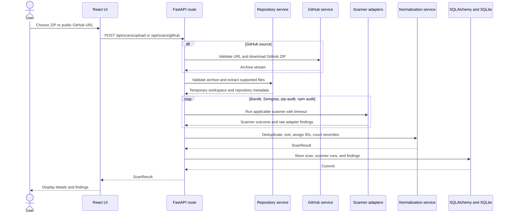

# Architecture

Sentinel AI has a browser frontend and a synchronous FastAPI backend. A scan is ingested into a temporary workspace, analyzed by the configured scanner adapters, normalized into the common finding schema, and persisted after the scanner pass completes.

## One scan

## Backend modules

| Module | Responsibility |
| --- | --- |
| `app/main.py` | Creates the FastAPI application, initializes the database during lifespan, installs CORS, upload limits, and security headers, and includes routers. |
| `app/api/routes/health.py` | Provides the health endpoint. |
| `app/api/routes/scans.py` | Accepts ZIP scans, lists history, returns scan details, queries findings, renders reports, and deletes scans. |
| `app/api/routes/github.py` | Accepts a GitHub URL and persists the resulting scan. |
| `app/api/routes/findings.py` | Generates, caches, refreshes, and returns AI explanations. |
| `app/api/routes/fixes.py` | Generates, caches, and returns AI fix suggestions. |
| `app/core/config.py` | Defines environment-backed `SENTINEL_` settings and their defaults. |
| `app/core/middleware.py` | Enforces early upload body limits and adds response security headers. |
| `app/core/security.py` | Validates archive member names and ensures extraction targets remain inside the workspace. |
| `app/services/repository_service.py` | Streams uploads, validates ZIP metadata, extracts supported text files, and builds repository metadata. |
| `app/services/github_service.py` | Parses public GitHub repository and branch URLs, downloads GitHub ZIP archives, and limits redirects and downloads. |
| `app/services/scan_service.py` | Limits concurrent scans, runs the default scanner sequence, and builds the normalized result. |
| `app/scanners/bandit_scanner.py` | Runs Bandit JSON analysis for Python files. |
| `app/scanners/semgrep_scanner.py` | Runs optional Semgrep with the local rule file for supported source extensions. |
| `app/scanners/pip_audit_scanner.py` | Audits exact pins collected from `requirements.txt` using pip-audit. |
| `app/scanners/npm_audit_scanner.py` | Audits `package-lock.json` files beside `package.json` using npm audit. |
| `app/scanners/base.py` | Defines scanner outcomes and bounded subprocess execution. |
| `app/services/normalization_service.py` | Normalizes severity and confidence, reads bounded snippets, deduplicates findings, and orders them. |
| `app/db/session.py` | Creates the SQLAlchemy engine and sessions and creates tables on startup. |
| `app/db/repository.py` | Saves scans and findings, lists scans, filters findings, and deletes scans. |
| `app/db/explanation_repository.py` | Persists and retrieves one explanation per finding. |
| `app/db/fixes.py` | Persists and retrieves one fix suggestion per finding. |
| `app/services/report_service.py` | Builds JSON and Markdown reports and keeps AI content opt-in. |
| `app/ai/provider.py` | Adapts Ollama and OpenAI-compatible chat APIs with response and timeout checks. |
| `app/ai/explanation_service.py` | Builds explanation prompts and validates model output. |
| `app/ai/patch_service.py` | Builds and validates human-reviewable unified diffs from model output. |

## Data model

The SQLAlchemy models are defined in `backend/app/db/models.py`. The default database URL points to SQLite.

### `scans`

`ScanRecord` stores one completed scan:

| Column | Meaning |
| --- | --- |
| `id` | 32-character scan identifier and primary key. |
| `archive_name` | Safe display name for the uploaded or downloaded archive. |
| `created_at` | Persisted creation timestamp. |
| `source_files` | Number of supported extracted source files. |
| `skipped_entries` | Archive entries skipped during extraction. |
| `total_bytes` | Total extracted source bytes. |
| `languages` | JSON language-to-file-count mapping. |
| `dependency_manifests` | JSON list of recognized manifest paths. |
| `scanner_runs` | JSON list containing scanner status, version, count, duration, and message. |
| `severity_counts` | JSON counts for normalized severities. |
| `findings_total` | Number of persisted findings. |

`ScanRecord.findings` is a one-to-many relationship with cascade delete-orphan.

### `findings`

`FindingRecord` stores normalized scanner evidence:

| Column | Meaning |
| --- | --- |
| `id` | Finding identifier and primary key. |
| `scan_id` | Foreign key to `scans.id`. |
| `position` | Stable result order within a scan. |
| `scanner` | Scanner adapter name. |
| `rule_id` | Scanner rule or advisory identifier. |
| `title` | Human-readable finding title. |
| `severity` | `critical`, `high`, `medium`, `low`, or `info`. |
| `confidence` | Normalized confidence value. |
| `category` | `security`, `bug`, or `quality`. |
| `file_path` | Relative source path. |
| `line_start`, `line_end` | Source location. |
| `evidence` | Scanner-provided evidence text. |
| `snippet` | Optional bounded source excerpt. |
| `cwe` | Optional CWE identifier. |
| `source` | Finding source, currently `static-analysis`. |

There are indexes on `scan_id`, `severity`, and the `(scan_id, position)` ordering.

### `explanations`

`ExplanationRecord` stores one optional AI explanation per finding. Its primary key is `finding_id`, and it stores `scan_id`, provider, model, creation time, summary, impact, confidence, remediation, and `evidence_sufficient`. It is related one-to-one to a finding.

### `fix_suggestions`

`FixSuggestionRecord` stores one optional AI proposal per finding. Its primary key is `finding_id`, and it stores `scan_id`, file path, provider, model, creation time, `can_fix`, rationale, an optional diff, and `syntax_check`. The stored diff is for review; the model does not modify the repository.

## Design decisions

- Scanner adapters return a common outcome so unavailable, skipped, failed, timed-out, partial, and completed tools remain visible in scan coverage.
- The scan service runs the default adapters in a fixed sequence and limits active scans with a bounded semaphore.
- ZIP input is extracted into a temporary directory and only supported text-like files are copied. The workspace is removed after the scan context exits.
- GitHub scanning uses a validated public repository or branch URL and GitHub's archive endpoint instead of cloning or executing repository code.
- Scanner evidence is kept independent from AI records. Reports omit AI by default and include it only when explicitly requested.
- Findings are deduplicated by scanner, rule, file path, and starting line, then sorted by severity and source location before IDs are assigned.
- The database is initialized with SQLAlchemy metadata at application startup; there are no migration files in the inspected backend.
